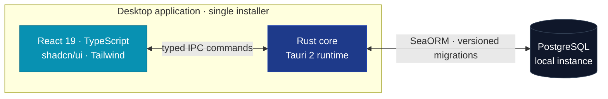

 

  

 

---

## ◆ What we build

**SynKode by NexaCore Co.** builds native desktop business software that does not need the cloud to work.

Every product ships as a single Windows installer, keeps its data in a local PostgreSQL database, and runs at full speed with the network unplugged. The interface is React. The engine underneath is Rust. Nothing between them is a browser tab pretending to be an app.

<table>
<tr>
<td width="25%" align="center"><b>Native, not wrapped</b> Rust core over Tauri 2, a few megabytes rather than a few hundred</td>
<td width="25%" align="center"><b>Your data stays yours</b> Local PostgreSQL, no telemetry, no vendor lock</td>
<td width="25%" align="center"><b>Bilingual by design</b> English and Arabic with true right-to-left layout</td>
<td width="25%" align="center"><b>Built to be audited</b> Role-based access, session expiry, activity trails</td>
</tr>
</table>

 

---

## ◆ Products

<table>
<tr>
<td width="50%" valign="top">

### 🧩 Synkode CRM

**Complete CRM and point of sale for retail and wholesale.**

Sales, inventory, purchasing and accounting in one binary. Warehouse-aware checkout with barcode entry, printable receipts, and a built-in calculator at the till.

`Point of sale` `Invoicing` `Quotations` `Sale orders`
`Stock transfers` `Purchase bills` `Cash registers`
`Profit and loss` `PDF and Excel export` `Dual currency`

</td>
<td width="50%" valign="top">

### 🛡️ ZTC Care & Warranty

**Customer care and warranty operations, end to end.**

Warranty claims from intake to delivery, with the parts inventory, payments and maintenance centers that surround them.

`Warranty tracking` `Order pipeline` `Parts inventory`
`Customer payments` `Maintenance centers` `Warehouses`
`Barcode scanning` `Activity log` `Auto-update`

</td>
</tr>
</table>

 

---

## ◆ How it fits together

 

---

## ◆ The stack

<table>
<tr><td><b>Interface</b></td><td>React 19 · TypeScript · Vite · Tailwind CSS · shadcn/ui · Radix · Recharts · TanStack Table</td></tr>
<tr><td><b>Core</b></td><td>Rust · Tauri 2 · typed command bridge · background services</td></tr>
<tr><td><b>Data</b></td><td>PostgreSQL · SeaORM · a standalone migration crate with versioned, reversible schema</td></tr>
<tr><td><b>Delivery</b></td><td>NSIS installer · built-in updater · GitHub Actions release pipeline</td></tr>
</table>

 

---

## ◆ Activity

 

Most of what we build lives in private repositories, so these counters show only a slice of the work.

 

